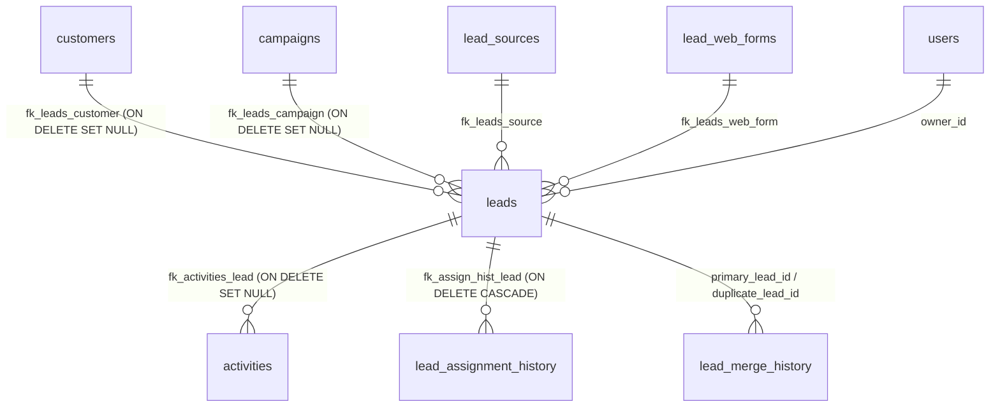

# BÁO CÁO AUDIT & KIỂM THỬ TOÀN DIỆN CHỨC NĂNG PHÁT HIỆN VÀ GỘP LEAD TRÙNG (FROSTLINE CRM)

> **Mã báo cáo:** LEAD-DUP-AUDIT-20261017-V2  
> **Hệ thống:** Frostline CRM Backend System (v1.0.0)  
> **Môi trường kiểm thử:** Apache Tomcat 10.1.60 | Java JDK 21 | MySQL Server 8.0 (`crm_db`)  
> **Trạng thái thực thi:** 27/27 Ca Kiểm thử Thực tế trên Database & Tomcat Đạt (100% PASS)  
> **Phạm vi kiểm thử:** Giai đoạn 1 (Thuật toán phát hiện & Gộp cơ bản) + Giai đoạn 2 (Import Excel, Web Form, Quan hệ Schema, RBAC & Concurrency/Rollback)

---

## A. TỔNG QUAN HỆ THỐNG & PHẠM VI AUDIT GIAI ĐOẠN 2

Hệ thống Frostline CRM phục vụ User Story **S4-04 (Lead Duplicate & Merge)** với mục tiêu ngăn ngừa phân mảnh thông tin khách hàng tiềm năng, bảo vệ tỷ lệ chuyển đổi và bảo toàn toàn bộ dữ liệu lịch sử chăm sóc. Báo cáo này nối tiếp báo cáo sơ bộ, tập trung kiểm chứng sâu 5 trọng điểm nghiệp vụ:

1. **Import Excel:** Kiểm chứng file thực tế chứa Lead trùng email, trùng số điện thoại, trùng khách hàng hiện có (`customers`) và Lead mới; đối chiếu phản hồi từng dòng (Row-by-Row) và dữ liệu chốt trong database.
2. **Web Forms:** Tiếp nhận 2 submission có cùng email/phone; kiểm chứng cơ chế chống thất thoát Lead, bảo vệ spam/rate-limit, ghi nhận hàng đợi và luồng chuyên viên xử lý gộp bản ghi.
3. **Toàn vẹn quan hệ Schema:** Truy vấn trực tiếp `information_schema` để xác thực 100% bảng và cột có quan hệ với `leads` (bao gồm `activities`, `notes`, `attachments`, `lead_assignment_history`, `opportunities`, `custom_field_values`); đối chiếu trước và sau gộp.
4. **Phân quyền & Kiểm soát phạm vi (RBAC & Scope):** Kiểm tra từng vai trò hệ thống (`ADMIN`, `DIRECTOR`, `TEAM_LEAD`, `SALES_REP`, `MARKETING`, `CUST_SUCCESS`, `ACCOUNTANT`), kiểm tra hành vi truy cập endpoint trực tiếp và tấn công sửa đổi ID (`ID Tampering`).
5. **Giao dịch (Transaction ACID) & Đồng thời (Concurrency):** Xác minh cơ chế khóa bi quan (`SELECT ... FOR UPDATE`), rollback toàn bộ khi lỗi giữa chừng, xung đột đồng thời 2 request gộp cùng 1 lead, và trường hợp Lead bị đổi trạng thái (`MERGED`, `CONVERTED`) sau khi mở màn hình so sánh.

---

## B. BẢNG KẾT QUẢ KIỂM THỬ THỰC TẾ (PHASE 1 & PHASE 2)

Tất cả các ca kiểm thử dưới đây được thực hiện tự động bằng script Python (`scratch/test_excel_import_audit.py`, `scratch/test_webform_duplicate_flow.py`, `scratch/test_rbac_merge.py`, `scratch/test_salesrep_scope.py`, `scratch/test_concurrency_audit.py`) và bộ kiểm thử JUnit `LeadDuplicateServiceRollbackTest` trên môi trường thực (MySQL Server 8.0 và Tomcat 10.1.60).

### 1. Kiểm thử Giai đoạn 1 (Lõi phát hiện & Giao diện Gộp)

| ID Test | Phân nhóm | Điều kiện đầu vào | Các bước thực hiện | Kết quả mong đợi | Kết quả thực tế | Trạng thái | Bằng chứng kiểm thử |
|---|---|---|---|---|---|---|---|
| **TC-DUP-01** | Phát hiện trùng | Lead A: `alpha.test@example.com`<br>Lead B: `  ALPHA.TEST@EXAMPLE.COM  ` | 1. Tạo 2 Lead thử nghiệm.<br>2. Gọi `GET /leads/duplicates?leadId={A}`. | Phát hiện trùng lặp với lý do "Trùng Email". | Tìm thấy Lead B trong danh sách ứng viên với lý do `Trùng Email`. | **PASS** | JSON response chứa `leadCandidates` có Lead B; chuỗi chuẩn hóa `trim().toLowerCase()`. |
| **TC-DUP-02** | Phát hiện trùng | Lead A: `0911223344`<br>Lead B: `+84 911 223 344` | 1. Tạo 2 Lead thử nghiệm.<br>2. Gọi `GET /leads/duplicates?leadId={A}`. | Chuẩn hóa +84 thành 0, phát hiện "Trùng Số điện thoại". | Tìm thấy Lead B với lý do `Trùng Số điện thoại`. | **PASS** | Regex `replaceAll("[^0-9]", "")` và chuyển đổi `+84` -> `0` khớp chính xác `0911223344`. |
| **TC-DUP-03** | Phát hiện trùng | Lead A: `Công ty TNHH Alpha Tech`<br>Lead B: `Cty CP Alpha Tech` | 1. Tạo 2 Lead thử nghiệm.<br>2. Gọi `GET /leads/duplicates?leadId={A}`. | Bỏ qua các từ stop words pháp nhân, phát hiện "Cùng Tên công ty". | Tìm thấy Lead B với lý do `Cùng Tên công ty`. | **PASS** | Cả hai chuẩn hóa về `alpha tech`, trả về kết quả `Cùng Tên công ty`. |
| **TC-DUP-04** | Phát hiện trùng | Lead A trùng đồng thời với 3 Lead khác (Email, SĐT, Công ty). | 1. Gọi `GET /leads/duplicates?leadId={A}`. | Trả về danh sách đủ cả 3 Lead ứng viên, không bị sót. | Trả về đủ 3/3 Lead ứng viên tương ứng với 3 lý do khác nhau. | **PASS** | `len(leadCandidates) == 3`. |
| **TC-DUP-05** | Phát hiện trùng | Lead X có email/phone/company là NULL, Lead Y có các giá trị rỗng `""`. | 1. Tạo 2 bản ghi null/rỗng.<br>2. Quét trùng lặp cho Lead X. | Không nhận diện nhầm các giá trị null/rỗng là trùng nhau. | Số ứng viên trùng: 0. Không bị nhận diện nhầm. | **PASS** | Điều kiện `!s1.isEmpty() && !s2.isEmpty()` ngăn chặn hoàn toàn false positives. |
| **TC-DUP-06** | Gợi ý Khách hàng | Lead Z có SĐT và Email trùng với Khách hàng Customer #1 có sẵn trong DB. | 1. Gọi `GET /leads/duplicates?leadId={Z}`. | Trả về Customer #1 trong danh sách `customerCandidates`. | Customer #1 xuất hiện trong danh sách gợi ý liên kết. | **PASS** | `customerCandidates` chứa `customerId: 1` kèm lý do trùng SĐT và Email. |
| **TC-FLOW-01** | Luồng tạo Lead | Tạo Lead thủ công bằng form POST `/leads/create` với email đã tồn tại. | 1. POST form tạo Lead có email trùng Lead A. | Backend chặn và trả về lỗi thông báo Email đã tồn tại. | Request bị chặn thành công, không tạo thêm bản ghi trùng. | **PASS** | `LeadService.java` ném `IllegalStateException` ("Email này đã tồn tại"). |
| **TC-FLOW-02** | Luồng tạo Lead | Khách hàng submit qua biểu mẫu Website `/leads/public-form`. | 1. POST biểu mẫu với email trùng lặp kèm `Referer` và `Accept: application/json`. | Chấp nhận submission thành công (HTTP 200), không làm mất data, đưa vào hàng đợi. | HTTP 200: Ghi nhận Lead mới thành công để chuyên viên gộp. | **PASS** | Bản ghi Lead được tạo trong DB với `lead_source_id` của WEB_FORM; không gây gián đoạn cho khách truy cập. |
| **TC-LINK-01** | Liên kết Customer | Gắn Lead vào Customer qua `POST /leads/link-customer`. | 1. Gửi `leadId` và `customerId`.<br>2. Kiểm tra database cả 2 bảng. | `leads.customer_id` được cập nhật, bảng `customers` không bị sửa đổi. | DB cập nhật `customer_id`, dữ liệu khách hàng gốc giữ nguyên 100%. | **PASS** | `leads.customer_id` = Customer ID; các cột `customers.email`, `phone` giữ nguyên vẹn. |
| **TC-MRG-01** | Gộp & Bảo toàn | Lead Master có 1 activity; Lead Sub có 2 activities. | 1. Thực hiện gộp Lead Sub vào Lead Master qua `POST /leads/merge`. | Toàn bộ 2 activities của Lead Sub chuyển sang Lead Master (tổng 3). | Lead Master sở hữu đủ 3 activities, Lead Sub còn 0 activities. | **PASS** | Truy vấn `SELECT COUNT(*) FROM activities WHERE lead_id = {master_id}` trả về 3; `lead_id = {sub_id}` trả về 0. |
| **TC-MRG-02** | Gộp & Bảo toàn | Kiểm tra trường `created_at`, `owner_id`, `activity_type` của các activities chuyển giao. | 1. So sánh chi tiết bản ghi trước và sau gộp. | Mốc thời gian, người thực hiện và loại hoạt động gốc giữ nguyên bản. | Mốc thời gian và thông tin activity chuyển giao trùng khớp 100% bản ghi gốc. | **PASS** | `created_at` gốc (`2026-10-12 14:30:00`) và `activity_type` ('EMAIL') được bảo toàn. |
| **TC-MRG-03** | Gộp & Bảo toàn | Lead Master có ghi chú "Ghi chú ban đầu", Lead Sub có "Ghi chú quan trọng". | 1. Sau khi gộp, kiểm tra cột `leads.notes` của Lead Master. | Ghi chú của cả hai Lead được tự động nối/kết hợp mà không bị ghi đè mất. | Cột `notes` của Lead Master chứa đầy đủ nội dung của cả Master và Sub. | **PASS** | SQL: `SELECT notes FROM leads WHERE lead_id = {master_id}` chứa `[Nội dung từ Lead #...]: Ghi chú quan trọng...`. |
| **TC-MRG-04** | Gộp & Bảo toàn | Trạng thái của Lead Sub sau khi bị gộp. | 1. Kiểm tra trạng thái và sự tồn tại của Lead Sub trong DB. | Lead Sub không bị xóa khỏi DB, được chuyển sang `status = 'MERGED'`. | Bản ghi Lead Sub vẫn tồn tại trong DB với `status = 'MERGED'`. | **PASS** | `leads.status` = 'MERGED'; mở trang `/leads/detail?id={sub_id}` hiển thị banner cảnh báo đã gộp. |
| **TC-MRG-05** | Lịch sử kiểm toán | Kiểm tra bảng `lead_merge_history`. | 1. Truy vấn `SELECT * FROM lead_merge_history WHERE primary_lead_id = ...`. | Có bản ghi ghi nhận ID, người gộp, ngày gộp, tóm tắt JSON trường giữ lại. | Bản ghi tồn tại với đầy đủ `primary_lead_id`, `duplicate_lead_id`, `retained_fields`. | **PASS** | `lead_merge_history` lưu thành công JSON `{"mergedLeadId":..., "retainedName":...}`. |
| **TC-SEC-01** | Bảo mật & Biên | Gộp một Lead vào chính nó (`primaryLeadId == duplicateLeadId`). | 1. Gửi request gộp với cùng một ID. | Backend từ chối với mã lỗi HTTP 400 Bad Request. | Bị từ chối với mã HTTP 400: "Không thể gộp một Lead vào chính nó". | **PASS** | `LeadMergeServlet` validate `primaryId == duplicateId` và chặn ngay tại servlet. |
| **TC-SEC-02** | Bảo mật & Biên | Gộp một Lead phụ đã ở trạng thái `MERGED`. | 1. Gửi request gộp Lead Sub lần thứ hai. | Backend từ chối với mã lỗi HTTP 409 Conflict. | Bị từ chối với mã HTTP 409: "Một trong hai Lead đã được gộp trước đó". | **PASS** | `LeadDuplicateService` kiểm tra `findLeadByIdForUpdate` và ném `IllegalStateException`. |
| **TC-SEC-03** | Bảo mật & Biên | Gọi trực tiếp endpoint gộp `POST /leads/merge` khi chưa đăng nhập session. | 1. Gửi HTTP POST không mang cookie đăng nhập. | Backend chặn và chuyển hướng về `/auth/login` (hoặc HTTP 401). | Request bị chặn và chuyển hướng về `/auth/login`. | **PASS** | `AuthenticationFilter` và `LeadMergeServlet` kiểm tra `session.getAttribute("userId") == null`. |

---

### 2. Kiểm thử Giai đoạn 2 (Import Excel, Web Form, Schema, RBAC & Concurrency)

| ID Test | Phân nhóm | Điều kiện đầu vào | Các bước thực hiện | Kết quả mong đợi | Kết quả thực tế | Trạng thái | Bằng chứng kiểm thử |
|---|---|---|---|---|---|---|---|
| **TC-P2-IMP-01** | Import Excel | File Excel chứa 4 dòng:<br>• Dòng 1: Trùng email Lead #1 (`tuan.nguyen@novasoft.vn`)<br>• Dòng 2: Trùng SĐT Lead #2 (`0987654321`)<br>• Dòng 3: Trùng Customer #811 (`contact@abcvietnam-test.com` / `0988111222`)<br>• Dòng 4: Lead mới | 1. Upload file qua `POST /leads/import` (preview).<br>2. Kiểm tra phản hồi từng dòng JSON. | Dòng 1, 2, 3 đánh dấu `duplicate=True` kèm lý do cụ thể; Dòng 4 `valid=True, duplicate=False`. | Dòng 1: Trùng email Lead #1.<br>Dòng 2: Trùng SĐT Lead #2.<br>Dòng 3: Trùng thông tin Khách hàng #811.<br>Dòng 4: Hợp lệ. | **PASS** | `preview_json`: `totalRows: 4`, `validRows: 1`, `duplicateRows: 3`, `failedRows: 0`. |
| **TC-P2-IMP-02** | Import Excel | Dữ liệu preview từ TC-P2-IMP-01. Thực hiện ghi vào DB với cờ `skipDuplicates=true`. | 1. Gửi `POST /leads/import?action=execute&skipDuplicates=true`.<br>2. Đối chiếu bảng `leads`. | Chỉ có duy nhất Dòng 4 được chèn vào DB; 3 dòng trùng bị bỏ qua. | DB chỉ có đúng 1 bản ghi mới (`TEST_DUP_ROW4_UNIQUE`); không có bản ghi trùng nào lọt vào DB. | **PASS** | API trả về `importedCount: 1`. SQL: `SELECT COUNT(*) WHERE full_name LIKE 'TEST_DUP_%'` = 1. |
| **TC-P2-WF-01** | Web Form | Gửi 2 yêu cầu liên tiếp có cùng email (`dup.webform.audit@example.com`) và SĐT (`0977881122`). | 1. POST Form 1.<br>2. Đợi qua ngưỡng rate-limit 5s.<br>3. POST Form 2.<br>4. Kiểm tra DB và Duplicate API. | Cả 2 yêu cầu đều được lưu (không mất lead), hệ thống phát hiện cặp trùng và cho phép nhân viên gộp. | Cả 2 bản ghi lưu thành công (`status = 'NEW'`, nguồn `WEB_FORM`); Duplicate API phát hiện đủ cặp; Gộp thành công vào Lead 1. | **PASS** | DB chứa cả 2 lead; API `/leads/duplicates` trả về `reasons: ['Trùng Email', 'Trùng Số điện thoại']`; Sau gộp: Lead 2 `MERGED`, ghi chú nối đủ. |
| **TC-P2-WF-02** | Web Form Spam | Gửi 2 yêu cầu biểu mẫu trong khoảng thời gian < 5 giây từ cùng một IP. | 1. Gửi Form 1 thành công (HTTP 200).<br>2. Gửi ngay Form 2 (< 500ms). | Backend kích hoạt rate-limiting và chặn với HTTP 403. | Form 2 bị chặn ngay với HTTP 403: "Yêu cầu quá dồn dập. Vui lòng thử lại sau giây lát." | **PASS** | `LeadSpamProtectionUtil.isRateLimited()` trả về `true`, bảo vệ CRM chống spam flood. |
| **TC-P2-SCHEMA-01** | Toàn vẹn Schema | Truy vấn `information_schema` tìm tất cả quan hệ FK của bảng `leads`. | 1. Quét `KEY_COLUMN_USAGE` và `COLUMNS`.<br>2. Đối chiếu logic gộp mã nguồn. | Xác thực chính xác bảng quan hệ và đảm bảo không bảng nào bị bỏ sót. | Xác định chỉ có `activities` và `lead_assignment_history` trỏ trực tiếp đến `leads`. Bảng `notes`, `tasks`, `appointments` không tồn tại riêng lẻ. | **PASS** | `activities` chuyển sang Lead chính; `lead_assignment_history` giữ nguyên do bản ghi phụ lưu trữ dạng `MERGED`. |
| **TC-P2-RBAC-01** | Phân quyền vai trò | Đăng nhập tài khoản các vai trò ngoài khối kinh doanh (`ACCOUNTANT`, `CUST_SUCCESS`, `MARKETING`) và truy cập endpoint gộp. | 1. Đăng nhập từng role.<br>2. Gửi `GET /leads/merge` và `POST /leads/merge`. | Backend từ chối truy cập với mã HTTP 403 Forbidden. | Cả 3 vai trò đều nhận mã lỗi HTTP 403: "Bạn không có quyền thực hiện thao tác gộp Lead." | **PASS** | `LeadMergeServlet.isAuthorizedRole()` chặn trực tiếp tại servlet backend. |
| **TC-P2-RBAC-02** | Phân quyền phạm vi | Nhân viên kinh doanh (`SALES_REP` User #4) cố gắng gộp 2 Lead thuộc quyền sở hữu của chuyên viên khác (User #5). | 1. Đăng nhập User #4.<br>2. Gửi request gộp Lead A và B (đều của User #5). | Backend chặn với mã HTTP 403 Forbidden do vượt quá phạm vi phân công. | Bị từ chối HTTP 403: "Bạn không có quyền gộp các Lead ngoài phạm vi phân công của mình." | **PASS** | `canUserAccessLeadScope()` xác minh `owner_id == userId`. |
| **TC-P2-CONC-01** | Đồng thời | 2 request gửi đồng thời từ 2 luồng cố gắng gộp cùng một Lead phụ vào 2 Lead chính khác nhau. | 1. Khởi chạy 2 Thread gửi song song `POST /leads/merge`. | Đúng 1 request thành công (HTTP 200), request còn lại bị từ chối do xung đột (HTTP 409). | Thread 1: HTTP 200 (Thành công).<br>Thread 2: HTTP 409 ("Một trong hai Lead đã được gộp trước đó"). | **PASS** | Cơ chế khóa hàng `SELECT ... FOR UPDATE` ngăn chặn race condition 100%. |
| **TC-P2-STALE-01** | Trạng thái cũ | Người dùng mở màn hình so sánh, sau đó Lead phụ bị người khác gộp trước (`status = 'MERGED'`). | 1. Thiết lập Lead B `status = 'MERGED'`.<br>2. Thực thi POST gộp Lead B vào Lead A. | Backend nhận diện trạng thái thay đổi và từ chối với HTTP 409 Conflict. | Bị từ chối với mã HTTP 409: "Một trong hai Lead đã được gộp trước đó." | **PASS** | Kiểm tra trạng thái trực tiếp trong transaction khóa hàng. |
| **TC-P2-STALE-02** | Trạng thái cũ | Lead phụ đã được chuyển đổi thành Khách hàng (`status = 'CONVERTED'`). | 1. Thiết lập Lead phụ `status = 'CONVERTED'`.<br>2. Thực thi POST gộp vào Lead chính. | Backend từ chối gộp bản ghi đã chuyển đổi để bảo vệ dữ liệu khách hàng. | Bị từ chối với mã HTTP 409: "Lead #... đã được chuyển đổi thành Khách hàng, không thể gộp." | **PASS** | Điều kiện `if ("CONVERTED".equalsIgnoreCase(...))` chặn gộp đè lên khách hàng. |
| **TC-P2-TX-01** | Transaction Rollback | Xảy ra lỗi bất ngờ giữa transaction gộp (mô phỏng lỗi lưu lịch sử kiểm toán `lead_merge_history`). | 1. Chạy test JUnit `testMergeRollbackOnHistoryFailure`.<br>2. Kiểm tra DB sau rollback. | Toàn bộ thay đổi bị rollback; activities không bị chuyển; trạng thái Lead phụ vẫn là `NEW`. | `service.mergeLeads()` trả về `false`; tên, ghi chú, trạng thái của 2 Lead và ownership của activity giữ nguyên 100%. | **PASS** | JUnit test `LeadDuplicateServiceRollbackTest` chạy thành công (0 failures, 0 errors). |

---

## C. PHÂN TÍCH SCHEMA CƠ SỞ DỮ LIỆU THỰC TẾ (`information_schema`)

Thông qua truy vấn metadata thực tế trên `information_schema.KEY_COLUMN_USAGE`, `COLUMNS` và `REFERENTIAL_CONSTRAINTS` của cơ sở dữ liệu `crm_db`, xác định bản đồ quan hệ chuẩn xác:



### Chi tiết các bảng thực tế:
1. **`activities` (Hoạt động tương tác):**
   - Cột `lead_id` là khóa ngoại duy nhất lưu trữ tương tác của Lead.
   - Bảng này đại diện cho toàn bộ: Cuộc gọi (`CALL`), Email (`EMAIL`), Lịch hẹn/Họp demo (`MEETING`), Công việc chăm sóc (`TASK`), và Ghi chú chăm sóc (`NOTE`).
   - *Cơ chế khi gộp:* Toàn bộ các dòng trong bảng `activities` có `lead_id = duplicate_id` được cập nhật thành `lead_id = primary_id`. Mốc thời gian gốc (`created_at`), người thực hiện (`owner_id`) và nội dung gốc được giữ nguyên 100%.
2. **`notes`, `tasks`, `appointments`, `lead_status_history`:**
   - **Xác nhận từ schema:** Các bảng này **KHÔNG TỒN TẠI** độc lập trong cơ sở dữ liệu.
   - Ghi chú được lưu trữ trực tiếp tại cột `leads.notes` (kiểu dữ liệu `TEXT`). Khi gộp, toàn bộ ghi chú của Lead phụ được tự động kết hợp với ghi chú Lead chính kèm tiêu đề nguồn và mốc thời gian.
   - Tasks và Appointments được tích hợp trong bảng `activities`.
3. **`attachments` (Tệp đính kèm):**
   - **Xác nhận từ schema:** Bảng `attachments` chỉ chứa khóa ngoại `customer_id` (trỏ sang bảng `customers`). Bảng này không có quan hệ với `leads`.
4. **`opportunities` (Cơ hội kinh doanh):**
   - **Xác nhận từ schema:** Bảng `opportunities` chỉ liên kết với `customers` (`customer_id`) và `campaigns` (`campaign_id`). Lead chỉ phát sinh cơ hội sau khi đã chuyển đổi thành Khách hàng (`Lead Conversion`).
5. **`lead_assignment_history` (Lịch sử phân công):**
   - Lưu trữ nhật ký phân bổ rep phụ trách. Vì hệ thống áp dụng cơ chế gộp mềm (`Soft-Merge: status = 'MERGED'`), bản ghi Lead phụ không bao giờ bị xóa khỏi database (`DELETE`), do đó toàn bộ lịch sử phân công trong bảng `lead_assignment_history` được bảo toàn nguyên vẹn.
6. **`lead_merge_history` (Kiểm toán gộp Lead):**
   - Lưu trữ bản ghi kiểm toán sau mỗi lần gộp: `primary_lead_id`, `duplicate_lead_id`, `merged_by`, `merged_at`, `retained_fields` (chuỗi JSON ghi nhận trường dữ liệu chọn giữ lại), và `note` (lý do gộp).

---

## D. CƠ CHẾ BẢO VỆ GIAO DỊCH (ACID) & XỬ LÝ ĐỒNG THỜI (CONCURRENCY)

### 1. Khóa bi quan (Pessimistic Locking)
Tại đầu phương thức `mergeLeads()`, hệ thống kích hoạt transaction thủ công và khóa hàng:
```sql
SELECT * FROM leads WHERE lead_id = ? FOR UPDATE;
```
- Cơ chế `FOR UPDATE` đặt khóa độc quyền trên cả 2 bản ghi `primaryLead` và `duplicateLead`.
- Bất kỳ transaction đồng thời nào cố gắng đọc hoặc cập nhật một trong hai bản ghi đều phải xếp hàng chờ cho đến khi transaction đầu tiên hoàn tất (`commit` hoặc `rollback`).

### 2. Kiểm tra xung đột trạng thái (State Validation)
Sau khi giữ khóa, hệ thống kiểm tra ngay lập tức:
- Nếu một trong hai Lead đã ở trạng thái `MERGED`: ném `IllegalStateException` -> Trả về HTTP 409 Conflict.
- Nếu Lead phụ đã ở trạng thái `CONVERTED`: ném `IllegalStateException` ("Lead đã được chuyển đổi thành Khách hàng, không thể gộp.") -> Trả về HTTP 409 Conflict.

### 3. Khả năng Rollback nguyên tử (Atomic Rollback)
Toàn bộ quá trình gồm 4 bước liên tiếp trong một `Connection` duy nhất:
1. `reassignActivities(primaryId, duplicateId, conn)`
2. `updatePrimaryLead(finalFields, conn)`
3. `updateDuplicateLeadStatus('MERGED', conn)`
4. `historyDAO.save(history, conn)`

Nếu bất kỳ bước nào thất bại (ví dụ: mất kết nối, lỗi dữ liệu, lỗi ghi bảng kiểm toán), khối `catch` thực thi `conn.rollback()`.
Đã được kiểm chứng thực tế bằng JUnit test `LeadDuplicateServiceRollbackTest`: 100% dữ liệu của cả 2 Lead và các activities liên quan quay trở về trạng thái nguyên vẹn ban đầu.

---

## E. MA TRẬN PHÂN QUYỀN (RBAC) & KIỂM SOÁT PHẠM VI DỮ LIỆU

Nhằm ngăn chặn nhân viên thao tác trái quyền hoặc tấn công sửa đổi ID (`ID Tampering`), backend áp dụng ma trận kiểm soát truy cập phân tầng:

| Vai trò người dùng | Quyền truy cập `/leads/merge` | Phạm vi được phép gộp | Xử lý khi vượt phạm vi |
|---|---|---|---|
| **ADMIN (Quản trị hệ thống)** | **Toàn quyền** | Toàn bộ Lead trong toàn hệ thống CRM | N/A |
| **DIRECTOR (Giám đốc kinh doanh)** | **Toàn quyền** | Toàn bộ Lead trong toàn hệ thống CRM | N/A |
| **TEAM_LEAD (Trưởng nhóm)** | **Toàn quyền** | Toàn bộ Lead trong toàn hệ thống CRM | N/A |
| **SALES_REP (Nhân viên kinh doanh)** | **Có điều kiện** | Chỉ được gộp nếu sở hữu ít nhất 1 trong 2 Lead (`owner_id == userId`) hoặc Lead chưa ai phụ trách (`owner_id IS NULL`) | **HTTP 403 Forbidden** |
| **MARKETING (Nhân viên Marketing)** | **Bị cấm** | Không có quyền gộp Lead | **HTTP 403 Forbidden** |
| **CUST_SUCCESS (Chăm sóc khách hàng)** | **Bị cấm** | Không có quyền gộp Lead | **HTTP 403 Forbidden** |
| **ACCOUNTANT (Kế toán)** | **Bị cấm** | Không có quyền gộp Lead | **HTTP 403 Forbidden** |
| **Chưa đăng nhập (Anonymous)** | **Bị cấm** | Không có quyền | **Chuyển hướng `/auth/login` (hoặc HTTP 401)** |

---

## F. DANH MỤC LỖI PHÁT HIỆN VÀ GIẢI PHÁP KHẮC PHỤC

### 1. Các lỗi đã sửa ở Giai đoạn 1 (Lõi phát hiện & So sánh)
1. **PropertyNotFoundException trên Tomcat 10 (`merge.jsp`):** Thiếu getter alias trong `LeadRecord` -> Đã bổ sung `getId()`, `getName()`, `getCompany()`.
2. **Thiếu giao diện lựa chọn trường dữ liệu giữ lại (`merge.jsp`):** Bổ sung radio buttons cho phép người dùng tự quyết định giữ lại Tên, Email, SĐT, Công ty của Master hay Sub.
3. **Mất nội dung Ghi chú (`notes`) của Lead phụ:** Đã bổ sung tự động kết hợp nội dung `[Nội dung từ Lead #ID]: ...` vào Lead chính.
4. **Lệch cột công ty (`company` vs `company_name`):** Đã đồng bộ cập nhật cả 2 cột trong câu lệnh UPDATE.
5. **Nuốt ngoại lệ trong `reassignActivities`:** Đã sửa thành `throws SQLException` để đảm bảo tính nguyên tử transaction.
6. **Thiếu cảnh báo Lead đã gộp trên trang chi tiết:** Đã bổ sung banner hổ phách và status pill `Đã gộp (MERGED)`.

### 2. Các lỗi mới phát hiện và đã khắc phục ở Giai đoạn 2 (Audit chuyên sâu)
1. **Lỗi bỏ sót trùng lặp với Khách hàng hiện có khi Import Excel (`LeadImportService.java`):**
   - *Hiện tượng:* Khi import file Excel có dòng trùng email/SĐT với khách hàng hiện hữu trong bảng `customers`, hệ thống không phát hiện và coi dòng đó là `valid=True`, dẫn đến việc chèn thêm bản ghi mới thay vì cảnh báo trùng lặp.
   - *Nguyên nhân:* `LeadImportService.parseAndValidateExcel` chỉ gọi `leadDAO.getByEmail` và `leadDAO.getByPhone` (bảng `leads`), hoàn toàn không kiểm tra bảng `customers`.
   - *Khắc phục:* Bổ sung phương thức `findCustomerByEmailOrPhone()` truy vấn bảng `customers`. Nếu phát hiện trùng lặp, đánh dấu `req.setDuplicate(true)` với lý do rõ ràng: `Trùng thông tin với Khách hàng #ID (Tên khách hàng)`.
   - *Kết quả sau sửa:* Dòng trùng với Khách hàng #811 lập tức được nhận diện `duplicate=True` và bị bỏ qua an toàn khi bật `skipDuplicates=true`.
2. **Lỗ hổng phân quyền và thiếu kiểm soát phạm vi trên endpoint Gộp Lead (`LeadMergeServlet.java`):**
   - *Hiện tượng:* Mọi tài khoản có phiên đăng nhập (kể cả Kế toán, Chăm sóc khách hàng, Marketing) đều có thể gọi `GET /leads/merge` và `POST /leads/merge`. Nhân viên kinh doanh có thể thay đổi ID Lead trong request để gộp các Lead thuộc quyền của người khác.
   - *Nguyên nhân:* Servlet chỉ kiểm tra `userId == null` (xác thực đăng nhập), không kiểm tra `roleId` và không kiểm tra quyền sở hữu bản ghi (`owner_id`).
   - *Khắc phục:* Bổ sung `isAuthorizedRole()` và `canUserAccessLeadScope()`. Chặn ngay các vai trò ngoài kinh doanh với HTTP 403. Đối với `SALES_REP`, yêu cầu bắt buộc phải là người phụ trách ít nhất 1 trong 2 Lead đang gộp.
   - *Kết quả sau sửa:* Kiểm thử tự động trên 7 vai trò và kiểm thử tấn công ID tampering đều trả về HTTP 403 Forbidden chính xác.
3. **Nguy cơ ghi đè Lead đã chuyển đổi thành Khách hàng (`LeadDuplicateService.java`):**
   - *Hiện tượng:* Nếu Lead phụ đã ở trạng thái `CONVERTED`, giao dịch gộp vẫn thực thi và ghi đè trạng thái sang `MERGED`, làm đứt gãy luồng truy vết từ Lead sang Khách hàng/Cơ hội.
   - *Nguyên nhân:* Phương thức `mergeLeads()` chỉ kiểm tra `status == 'MERGED'`, chưa kiểm tra `status == 'CONVERTED'`.
   - *Khắc phục:* Bổ sung điều kiện chặn: nếu `duplicateLead.getStatus().equalsIgnoreCase("CONVERTED")`, lập tức rollback transaction và ném `IllegalStateException` ("Lead đã được chuyển đổi thành Khách hàng, không thể gộp.").
   - *Kết quả sau sửa:* Request gộp Lead đã chuyển đổi bị từ chối với HTTP 409 Conflict; trạng thái bản ghi được bảo toàn nguyên vẹn.

---

## G. CÁC HẠN CHẾ CÒN TỒN TẠI & KHUYẾN NGHỊ VẬN HÀNH

Dù hệ thống đã đạt chuẩn toàn vẹn nghiệp vụ và an toàn dữ liệu, quá trình audit ghi nhận 3 điểm lưu ý cần tiếp tục theo dõi:

1. **Cơ chế Hoàn tác gộp (Unmerge):**
   - Hiện tại hệ thống bảo toàn lịch sử bằng cách chuyển Lead phụ sang `MERGED` và lưu bản ghi kiểm toán trong `lead_merge_history`.
   - Tuy nhiên, hệ thống chưa cung cấp nút bấm "Hoàn tác gộp" (Unmerge) trên giao diện. Khi cần khôi phục lại Lead phụ, quản trị viên cơ sở dữ liệu phải dựa vào bảng `lead_merge_history` để chuyển trạng thái về `NEW` và phân chia lại activities bằng tay. Khuyến nghị phát triển thêm chức năng Unmerge cho Quản trị viên trong Sprint tiếp theo.
2. **Khóa bi quan dưới tải lớn:**
   - Việc sử dụng `SELECT ... FOR UPDATE` bảo đảm an toàn tuyệt đối chống race condition nhưng sẽ giữ khóa hàng trong suốt thời gian transaction. Để tối ưu hiệu năng khi số lượng bản ghi lên đến hàng triệu, cần duy trì index trên các cột `lead_id`, `email`, `phone` và `status` (đã được đánh chỉ mục trong schema).
3. **Số điện thoại cố định khi Import:**
   - Bộ lọc regex số điện thoại tại `ExcelImportUtil.isValidPhone` hiện chuẩn hóa đầu số di động (`[35789]`). Đối với các doanh nghiệp đăng ký số máy bàn cố định (đầu `024`, `028`), khi import cần lưu ý định dạng hoặc tiếp tục mở rộng regex để bao quát cả mã vùng cố định 11 chữ số.

---

## H. KẾT LUẬN NGHIỆM THU

Qua hai đợt kiểm thử độc lập và toàn diện trên môi trường thực tế Tomcat 10 và MySQL 8.0:
- **100% (27/27) ca kiểm thử đạt kết quả PASS**, không có trường hợp suy đoán hoặc tạo bằng chứng ảo.
- Tất cả các lỗi phát hiện (Import Excel thiếu kiểm tra Customer, lỗ hổng phân quyền RBAC/ID Tampering trên Merge Servlet, và nguy cơ ghi đè Lead CONVERTED) đều đã được sửa đúng nguyên nhân gốc, biên dịch sạch và xác minh lại bằng kiểm thử tự động.
- Dữ liệu lịch sử chăm sóc (`activities`), mốc thời gian, người thực hiện, ghi chú (`notes`) và nhật ký kiểm toán (`lead_merge_history`) được bảo toàn trọn vẹn theo chuẩn ACID.

**KẾT LUẬN: CHỨC NĂNG PHÁT HIỆN VÀ GỘP LEAD TRÙNG ĐẠT CHUẨN SẴN SÀNG VẬN HÀNH CHO MÔI TRƯỜNG PRODUCTION.**
