# BÁO CÁO NGHIỆM THU HOÀN THIỆN CHỨC NĂNG BIỂU MẪU THU THẬP LEAD CÔNG KHAI (PUBLIC LEAD FORM)
**Thời gian thực hiện:** 18/10/2026  
**Môi trường:** Java 17, Jakarta EE 10, Apache Tomcat 10.1.60, MySQL 8.0  
**URL biểu mẫu mục tiêu:** `/crm-backend-1.0.0/leads/public-form?formId=11`  

---

## 1. CÁC FILE ĐÃ CHỈNH SỬA VÀ BỔ SUNG

| STT | Đường dẫn file | Mục đích điều chỉnh |
|---|---|---|
| 1 | `Backend/src/main/java/com/crm/controller/lead/LeadPublicFormServlet.java` | Hoàn thiện endpoint tiếp nhận công khai: loại bỏ cơ chế tự ý fallback khi form không tồn tại/vô hiệu hóa, chuẩn hóa phản hồi HTTP status (200, 400, 403, 404, 500), bảo mật không lộ SQL exception, hỗ trợ cả JSON AJAX và form submit thông thường. |
| 2 | `Backend/src/main/java/com/crm/service/LeadWebFormService.java` | Bổ sung phương thức `submitAndCreateLead` trả về thực thể `Lead` kèm ID thật từ DB, validate nghiêm ngặt format Họ tên/Email/SĐT Việt Nam ở Backend, chuẩn hóa phân tách `firstName`/`lastName`, gán đúng nguồn `WEB_FORM` (source_id = 1). |
| 3 | `Backend/src/main/java/com/crm/dao/LeadDAO.java` | Bổ sung đồng bộ các cột `company_name` và `contact_name` khi tạo Lead nhằm tương thích toàn diện với tất cả các mô-đun khác trong CRM (chuyển đổi Lead, danh sách lọc, gộp trùng). |
| 4 | `Backend/src/main/webapp/WEB-INF/views/leads/public-form.jsp` | Bổ sung container hiển thị thông báo lỗi từ server (`#serverAlertBox`), thông báo lỗi realtime (`#clientAlertBox`), khung thông báo gửi thành công bằng AJAX (`#ajaxSuccessBox`), giữ nguyên 100% giao diện, CSS và các trường nhập liệu. |
| 5 | `Backend/src/main/webapp/assets/js/modules/lead-web-form.js` | Nâng cấp luồng submit client: validate cơ bản nâng cao trải nghiệm, bắt sự kiện submit gửi qua Fetch API với `Accept: application/json`, hiển thị spinner `Đang gửi thông tin...`, chặn double-click gửi lặp, hiển thị lỗi tiếng Việt và giữ nguyên dữ liệu đã nhập nếu có lỗi. |
| 6 | `Backend/src/test/java/com/crm/service/PublicLeadFormRealSubmissionTest.java` | Bộ kiểm thử tích hợp và tự động hóa bao quát 7 kịch bản (7/7 test passed). |

---

## 2. LUỒNG XỬ LÝ TRƯỚC VÀ SAU KHI SỬA

```mermaid
flowchart TD
    subgraph Truoc_Khi_Sua["Luồng Trước Khi Sửa"]
        A1["Khách hàng truy cập ?formId=11"] --> B1["Servlet doGet"]
        B1 --> C1["Nếu form lỗi/sai ID: Tự ý fallback lấy form đầu tiên bất kỳ"]
        A2["Khách hàng bấm gửi form"] --> B2["JS disable nút, submit form POST"]
        B2 --> C2["Lỗi server trả về 500, forward JSP nhưng JSP thiếu thẻ alert lỗi"]
        C2 --> D2["Người dùng không thấy thông báo, mất dữ liệu đã nhập"]
    end

    subgraph Sau_Khi_Sua["Luồng Sau Khi Hoàn Thiện"]
        A3["Khách hàng truy cập ?formId=11"] --> B3["Servlet doGet kiểm tra chính xác ID và isActive"]
        B3 -->|Form không tồn tại/Khóa| C3["Trả về HTTP 404 & Giao diện thông báo đóng form"]
        B3 -->|Hợp lệ| D3["Render Form 11 với đầy đủ trường"]

        D3 --> E3["Khách hàng nhập dữ liệu & bấm Gửi"]
        E3 --> F3["JS validate format: Họ tên, Email, SĐT VN"]
        F3 -->|Không hợp lệ| G3["Hiển thị alert tiếng Việt, focus trường lỗi, GIỮ NGUYÊN FORM DATA"]
        F3 -->|Hợp lệ| H3["Nút chuyển spinner 'Đang gửi...', chặn double click, gửi Fetch AJAX"]
        
        H3 --> I3["Backend Servlet doPost"]
        I3 --> J3["Kiểm tra Honeypot, Rate-limit, Allowed Domains"]
        J3 --> K3["Backend Validation: Họ tên, Email regex, SĐT VN (0/84)"]
        K3 --> L3["LeadWebFormService: Tách first/last name, gán nguồn WEB_FORM"]
        L3 --> M3["LeadDAO: Ghi vào bảng 'leads' qua PreparedStatement an toàn"]
        M3 --> N3["Lấy ID tự sinh từ CSDL (GeneratedKeys)"]
        N3 --> O3["Trả HTTP 200 JSON kèm leadId thật"]
        O3 --> P3["Frontend chuyển sang màn hình 'Gửi thành công' mượt mà, hỗ trợ gửi tiếp"]
    end
```



---

## 3. ENDPOINT VÀ PAYLOAD THỰC TẾ

### 3.1. Endpoint tiếp nhận
- **URL:** `/crm-backend-1.0.0/leads/public-form` (hoặc `/public/leads`, `/leads/public`)
- **HTTP Method:** `POST`
- **Content-Type:** `application/x-www-form-urlencoded; charset=UTF-8`
- **Accept:** `application/json` (cho AJAX) hoặc `text/html` (cho form submit truyền thống)

### 3.2. Payload gửi lên (Form Data)
| Tham số | Kiểu dữ liệu | Bắt buộc | Ví dụ giá trị | Ghi chú |
|---|---|---|---|---|
| `formId` | int | Có | `11` | ID biểu mẫu trong bảng `lead_web_forms` |
| `fullName` | String | Có | `Lê Hoàng Minh Live` | Họ và tên khách hàng |
| `email` | String | Có | `lehoangminh_6237@frostline.com` | Địa chỉ email liên hệ |
| `phone` | String | Có | `0978123456` | Số điện thoại di động |
| `company` | String | Không | `Công Ty Công Nghệ Frostline` | Đơn vị / tổ chức công tác |
| `notes` | String | Không | `Khách hàng đăng ký tư vấn CRM` | Nhu cầu tư vấn / ghi chú |
| `website_hp` | String | Ẩn | `""` (rỗng) | Honeypot chống bot tự động |
| `campaignId` | int | Không | `null` hoặc ID chiến dịch | Gắn nguồn chiến dịch marketing |

### 3.3. Cấu trúc phản hồi thực tế từ Backend
#### Phản hồi thành công (HTTP 200 OK):
```json
{
  "status": "success",
  "message": "Cảm ơn bạn đã gửi thông tin! Chúng tôi sẽ liên hệ lại sớm nhất.",
  "leadId": 222
}
```

#### Phản hồi lỗi định dạng / thiếu trường (HTTP 400 Bad Request):
```json
{
  "status": "error",
  "message": "Số điện thoại không đúng định dạng Việt Nam."
}
```

#### Phản hồi phát hiện spam bot / rate-limit (HTTP 403 Forbidden):
```json
{
  "status": "error",
  "message": "Phát hiện hoạt động tự động (Spam bot)."
}
```

#### Phản hồi biểu mẫu không tồn tại / ngừng nhận (HTTP 404 Not Found):
```json
{
  "status": "error",
  "message": "Biểu mẫu thu thập không tồn tại hoặc đã bị ngừng kích hoạt."
}
```

---

## 4. BẢNG VÀ CỘT DATABASE ĐƯỢC SỬ DỤNG

### 4.1. Bảng cấu hình biểu mẫu: `lead_web_forms`
- `form_id`: Khóa chính (kiểm tra `form_id = 11`).
- `form_name`: Tên biểu mẫu (hiển thị trên tiêu đề thẻ và trang).
- `is_active`: Trạng thái hoạt động (`1 = đang kích hoạt`).
- `spam_protection_enabled`: Cờ bật chống spam bot (`1 = bật`).
- `allowed_domains`: Danh sách domain cho phép (rỗng hoặc `*` cho phép mọi domain).
- `lead_source_id`: Nguồn Lead liên kết (nếu null, hệ thống tự động gán nguồn `WEB_FORM` - `source_id = 1`).
- `success_redirect_url`: Đường dẫn chuyển hướng sau khi gửi (nếu có cấu hình).

### 4.2. Bảng lưu trữ Lead: `leads`
Khi khách hàng gửi form, backend thực hiện lệnh `INSERT INTO leads`:
| Cột trong CSDL | Kiểu dữ liệu | Giá trị được lưu |
|---|---|---|
| `lead_id` | INT AUTO_INCREMENT | Sinh tự động bởi MySQL (ví dụ: `222`) |
| `full_name` | VARCHAR(150) | Họ và tên khách hàng nhập |
| `first_name` | VARCHAR(100) | Tách từ họ tên (VD: `Minh`) |
| `last_name` | VARCHAR(100) | Tách họ và đệm (VD: `Lê Hoàng`) |
| `contact_name` | VARCHAR(150) | Đồng bộ từ `full_name` phục vụ các màn hình chuyển đổi / gộp |
| `company` | VARCHAR(200) | Tên công ty/đơn vị do khách hàng nhập |
| `company_name` | VARCHAR(200) | Đồng bộ từ `company` |
| `email` | VARCHAR(150) | Email liên hệ đã validate |
| `phone` | VARCHAR(50) | Số điện thoại đã chuẩn hóa ký tự |
| `lead_source_id` | INT | `1` (Nguồn: *Biểu mẫu Website*) |
| `web_form_id` | INT | `11` (Liên kết chính xác tới Form #11) |
| `status` | VARCHAR(50) | `'NEW'` (Trạng thái mặc định chuẩn CRM) |
| `rating` | VARCHAR(20) | `'WARM'` (Phân loại tiềm năng ban đầu) |
| `notes` | TEXT | Nội dung tư vấn / ghi chú yêu cầu |
| `created_at` | TIMESTAMP | Thời gian tạo thực tế (`CURRENT_TIMESTAMP`) |

---

## 5. BẰNG CHỨNG KIỂM THỬ VÀ TRUY VẤN XÁC NHẬN

### 5.1. Bằng chứng kiểm thử tự động (Unit & Integration Test Suite)
Đã thực thi bộ kiểm thử `PublicLeadFormRealSubmissionTest` qua Maven:
```
[INFO] -------------------------------------------------------
[INFO]  T E S T S
[INFO] -------------------------------------------------------
[INFO] Running com.crm.service.PublicLeadFormRealSubmissionTest
[INFO] Tests run: 7, Failures: 0, Errors: 0, Skipped: 0, Time elapsed: 3.373 s -- in com.crm.service.PublicLeadFormRealSubmissionTest
[INFO] Results:
[INFO] Tests run: 7, Failures: 0, Errors: 0, Skipped: 0
[INFO] ------------------------------------------------------------------------
[INFO] BUILD SUCCESS
[INFO] ------------------------------------------------------------------------
```
Chi tiết các ca kiểm thử đã pass:
1. `TC-01`: Gửi form với dữ liệu thật hợp lệ và xác nhận lưu thành công vào Database.
2. `TC-02`: Validate bắt buộc họ tên, email, số điện thoại ở Backend.
3. `TC-03`: Kiểm tra formId không tồn tại hoặc form bị ngưng hoạt động trả về lỗi thích hợp.
4. `TC-04`: Kiểm tra cơ chế chống Spam Bot (Honeypot, Từ khóa rác, Email tạm thời).
5. `TC-05`: Kiểm tra `LeadPublicFormServlet` xử lý AJAX JSON Request thành công (status 200).
6. `TC-06`: Kiểm tra `LeadPublicFormServlet` xử lý lỗi dữ liệu không hợp lệ trả về HTTP 400.
7. `TC-07`: Kiểm tra `LeadPublicFormServlet` doGet với form không tồn tại trả về HTTP 404.

### 5.2. Bằng chứng gửi Live và truy vấn CSDL phát triển thực tế
Gửi request thật đến Tomcat: `http://localhost:8080/crm-backend-1.0.0/leads/public-form`
- **Kết quả HTTP Response:**
  ```
  status  : success
  message : Cảm ơn bạn đã gửi thông tin! Chúng tôi sẽ liên hệ lại sớm nhất.
  leadId  : 222
  ```
- **Kết quả truy vấn trực tiếp từ bảng `leads` trong cơ sở dữ liệu `crm_db`:**
  ```sql
  SELECT lead_id, full_name, contact_name, email, phone, company, company_name, 
         web_form_id, lead_source_id, status, rating, notes, created_at 
  FROM leads WHERE lead_id = 222;
  ```
- **Dữ liệu thực tế được lưu trong CSDL:**
  ```
  lead_id        : 222
  full_name      : Lê Hoàng Minh Live
  contact_name   : Lê Hoàng Minh Live
  email          : lehoangminh_6237@frostline.com
  phone          : 0978123456
  company        : Công Ty Công Nghệ Phần Mềm Frostline
  company_name   : Công Ty Công Nghệ Phần Mềm Frostline
  web_form_id    : 11
  lead_source_id : 1
  status         : NEW
  rating         : WARM
  notes          : Khách hàng đăng ký tư vấn giải pháp CRM thực tế từ form live.
  created_at     : 2026-10-19 00:30:03.0
  ```

Bản ghi Lead mới (`lead_id = 222`) hoàn toàn xuất hiện trên màn hình danh sách Lead của CRM (`/leads`) với nguồn gốc *"Biểu mẫu Website"*, biểu mẫu *"Form test"*, trạng thái *"NEW"* và mức độ *"WARM"*.

---

## 6. HƯỚNG DẪN TỰ KIỂM TRA TRÊN TRÌNH DUYỆT

Người dùng có thể trực tiếp kiểm thử trên trình duyệt (Chrome, Edge, Firefox):

1. **Truy cập biểu mẫu:**
   Mở trình duyệt và vào địa chỉ:
   `http://localhost:8080/crm-backend-1.0.0/leads/public-form?formId=11`
   - Biểu mẫu sẽ tải lên với tiêu đề *"Form test"*, đầy đủ các trường nhập liệu.

2. **Kiểm tra Validate tại chỗ & giữ nguyên dữ liệu:**
   - Để trống ô Email hoặc nhập số điện thoại sai (ví dụ `12345`) rồi bấm *"Gửi thông tin tư vấn"*.
   - Thông báo lỗi hiển thị rõ ràng bằng tiếng Việt ngay trên form.
   - Dữ liệu ở các ô khác đã nhập không bị mất.

3. **Gửi dữ liệu hợp lệ:**
   - Nhập:
     - **Họ và tên:** `Nguyễn Văn Khách Hàng`
     - **Email:** `khachhang@example.com`
     - **Số điện thoại:** `0912345678`
     - **Công ty:** `Công Ty ABC`
     - **Nội dung tư vấn:** `Tôi muốn tư vấn bảng giá CRM cho doanh nghiệp`
   - Bấm *"Gửi thông tin tư vấn"*.
   - Nút bấm lập tức chuyển thành biểu tượng xoay và chữ *"Đang gửi thông tin..."* (ngăn bấm đúp).
   - Form chuyển sang màn hình xanh thành công: *"Gửi thông tin thành công! Cảm ơn bạn đã gửi thông tin! Chúng tôi sẽ liên hệ lại sớm nhất."* kèm nút *"Gửi thêm phản hồi khác"*.

4. **Kiểm tra trong hệ thống CRM:**
   - Đăng nhập vào trang quản trị CRM tại `http://localhost:8080/crm-backend-1.0.0/leads`.
   - Lead mới vừa gửi sẽ xuất hiện ở dòng đầu tiên của danh sách với đầy đủ chi tiết.

5. **Kiểm tra từ chối form không hợp lệ:**
   - Truy cập `http://localhost:8080/crm-backend-1.0.0/leads/public-form?formId=999999`.
   - Trình duyệt sẽ hiển thị trang báo lỗi HTTP 404: *"Không tìm thấy biểu mẫu - Biểu mẫu thu thập này không tồn tại hoặc đã tạm dừng tiếp nhận phản hồi từ hệ thống."* (không bị fallback sai lệch sang form khác).

---

## 7. NHỮNG VẤN ĐỀ CÒN TỒN TẠI VÀ KHUYẾN NGHỊ

1. **Tùy biến động các trường (Dynamic Fields JSON):**
   - Hiện tại biểu mẫu thu thập hiển thị theo cấu trúc trường cố định chuẩn (Họ tên, Email, SĐT, Công ty, Ghi chú). Bảng `lead_web_forms` có cột `fields_json` dự kiến hỗ trợ cấu hình bật/tắt động từng trường trong các sprint tương lai.
2. **Cấu hình SMTP gửi email tự động:**
   - Hệ thống hiện tại lưu trữ Lead chuẩn vào CSDL. Nếu triển khai tính năng gửi email xác nhận tức thì cho khách hàng (Auto-responder Email), cần cấu hình thêm thông số SMTP trong `db.properties` hoặc thiết lập tích hợp SendGrid/Mailgun.
3. **Cơ chế Rate Limit:**
   - Cơ chế giới hạn tần suất gửi dựa trên IP đang đặt ở mức 5 giây/lần gửi từ cùng 1 IP (`MIN_SUBMISSION_INTERVAL_MS = 5000`). Đây là mức phù hợp để chống spam bot đồng thời không cản trở trải nghiệm khách hàng thật.
