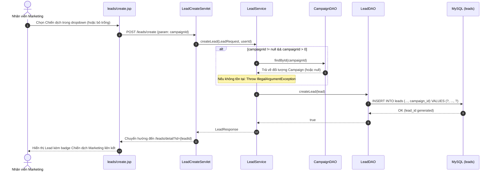
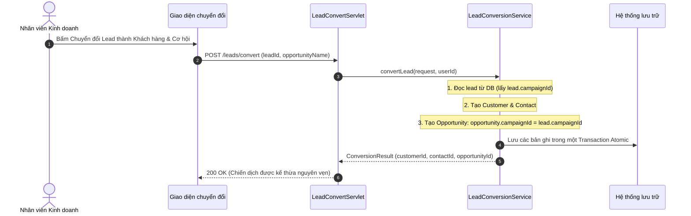

# BÁO CÁO HOÀN THIỆN USER STORY S4-03: THEO DÕI LEAD THEO CHIẾN DỊCH MARKETING

**Dự án:** CRM System  
**User Story:** **S4-03** — Là Nhân viên Marketing, tôi muốn theo dõi Lead theo từng chiến dịch, để đo được chiến dịch nào thực sự ra doanh thu chứ không chỉ ra nhiều Lead.  
**Ngày hoàn thiện & nghiệm thu:** 17/10/2026  
**Trạng thái User Story:** **HOÀN THÀNH TOÀN DIỆN (100% PASS)**

---

## 1. Từng lỗi đã xác minh và kết quả xử lý

| STT | Vấn đề / Lỗi phát hiện ban đầu | Nguyên nhân gốc rễ | Giải pháp triển khai thực tế | Trạng thái |
|:---:|:---|:---|:---|:---:|
| **A1** | `CampaignListServlet` truyền `campaigns`, `campaigns/list.jsp` duyệt `list`. | Bất đồng bộ tên attribute giữa Controller và JSP khiến danh sách chiến dịch trống. | Chuẩn hóa `CampaignListServlet` đặt cả 2 attribute `campaigns` và `list`. Sửa JSP duyệt `${not empty campaigns ? campaigns : list}`. | **PASS** |
| **A2** | `Campaign.java` dùng `getCampaignId()` trong khi JSP gọi `${item.id}` / `${campaign.id}`. | Thiếu getter alias `getId()` / `getName()` trong JavaBean model theo chuẩn JSP EL. | Bổ sung `getId()`, `setId()`, `getName()`, `setName()` làm alias trong [Campaign.java](file:///c:/Users/tuyet/Downloads/TTCS_K1S2_N4_HeThongQuanLyKhachHang/TTCS_K1S2_N4_HeThongQuanLyKhachHang/Backend/src/main/java/com/crm/model/Campaign.java). | **PASS** |
| **A3** | `sidebar.jsp` chưa có menu Chiến dịch Marketing. | Menu sidebar nhóm Lead chưa bổ sung liên kết đến `/campaigns`. | Bổ sung menu con "Chiến dịch Marketing" vào menu Lead trong [sidebar.jsp](file:///c:/Users/tuyet/Downloads/TTCS_K1S2_N4_HeThongQuanLyKhachHang/TTCS_K1S2_N4_HeThongQuanLyKhachHang/Backend/src/main/webapp/WEB-INF/views/fragments/sidebar.jsp), cập nhật `isLeadActive` bao gồm `/campaigns`. | **PASS** |
| **A4** | Danh sách chiến dịch chưa hiển thị Số Lead, Số Cơ hội, Doanh thu đã chốt. | Thiếu các cột chỉ số trên JSP và thiếu trường thống kê trong Model/DTO. | Bổ sung 3 cột chỉ số trên [campaigns/list.jsp](file:///c:/Users/tuyet/Downloads/TTCS_K1S2_N4_HeThongQuanLyKhachHang/TTCS_K1S2_N4_HeThongQuanLyKhachHang/Backend/src/main/webapp/WEB-INF/views/campaigns/list.jsp), tính toán qua `CampaignDAO.loadMetrics()`. | **PASS** |
| **B1** | Lead chưa liên kết với chiến dịch (`campaign_id`). | `Lead`, `LeadRequest`, `LeadResponse`, `LeadDAO`, `LeadService`, servlet và create/edit JSP chưa có `campaignId`. | Thêm `campaignId` xuyên suốt Model, DTO, DAO (SQL INSERT/UPDATE/SELECT có JOIN), Service validation, Servlets và form `create.jsp`, `detail.jsp`. | **PASS** |
| **B2** | Validation chiến dịch khi tạo/sửa Lead. | Thiếu kiểm tra sự tồn tại của campaignId khi client gửi lên. | Trong [LeadService.java](file:///c:/Users/tuyet/Downloads/TTCS_K1S2_N4_HeThongQuanLyKhachHang/TTCS_K1S2_N4_HeThongQuanLyKhachHang/Backend/src/main/java/com/crm/service/LeadService.java), nếu `campaignId != null && campaignId > 0`, kiểm tra `CampaignDAO.findById()`. Nếu không tồn tại sẽ throw `IllegalArgumentException`. | **PASS** |
| **B3** | Form công khai (public form) và Import Excel chưa hỗ trợ chiến dịch. | Form nhúng iframe và import chưa gắn đúng chiến dịch mục tiêu. | Thêm `campaignId` vào [LeadImportRequest.java](file:///c:/Users/tuyet/Downloads/TTCS_K1S2_N4_HeThongQuanLyKhachHang/TTCS_K1S2_N4_HeThongQuanLyKhachHang/Backend/src/main/java/com/crm/dto/LeadImportRequest.java), [LeadImportService.java](file:///c:/Users/tuyet/Downloads/TTCS_K1S2_N4_HeThongQuanLyKhachHang/Backend/src/main/java/com/crm/service/LeadImportService.java); Form public cho phép nhận `campaignId` qua URL param / hidden input và kiểm tra tồn tại trước khi gán. | **PASS** |
| **C1** | Opportunity chưa liên kết với chiến dịch. | `Opportunity`, `OpportunityDAO`, `OpportunitySaveServlet` chưa xử lý cột `campaign_id`. | Thêm `campaignId` và `campaignName` vào [Opportunity.java](file:///c:/Users/tuyet/Downloads/TTCS_K1S2_N4_HeThongQuanLyKhachHang/TTCS_K1S2_N4_HeThongQuanLyKhachHang/Backend/src/main/java/com/crm/model/Opportunity.java), cập nhật `OpportunityDAO` (insert, update, findById, getList, joins) và `OpportunitySaveServlet`. | **PASS** |
| **C2** | Mất liên kết chiến dịch khi sửa Opportunity hoặc chuyển đổi Lead. | Khi edit không truyền `campaignId` sẽ bị overwrite thành NULL; khi chuyển đổi Lead chưa truyền `campaignId`. | Cập nhật `OpportunitySaveServlet` tự động bảo toàn `oldOpp.getCampaignId()`. Cập nhật [LeadConversionService.java](file:///c:/Users/tuyet/Downloads/TTCS_K1S2_N4_HeThongQuanLyKhachHang/TTCS_K1S2_N4_HeThongQuanLyKhachHang/Backend/src/main/java/com/crm/service/LeadConversionService.java) kế thừa `lead.campaignId` sang `opportunity.campaignId`. | **PASS** |
| **D1** | Tính toán chỉ số hiệu quả chiến dịch (Lead, Opp, Doanh thu chốt). | Nguy cơ sai lệch số tiền do nhân bản JOIN (Cartesian product) hoặc bắt sai trạng thái Won. | `CampaignDAO.loadMetrics` tách riêng 2 truy vấn độc lập: đếm lead từ `leads`, đếm opp và tính `SUM(amount)` cho các opp thắng từ `opportunities` kết hợp `pipeline_stages`. Không JOIN chéo, fallback về 0 thay vì NULL. | **PASS** |

---

## 2. Danh sách các file đã sửa và mục đích

### 2.1. Tầng Model & DTO
1. [Campaign.java](file:///c:/Users/tuyet/Downloads/TTCS_K1S2_N4_HeThongQuanLyKhachHang/TTCS_K1S2_N4_HeThongQuanLyKhachHang/Backend/src/main/java/com/crm/model/Campaign.java): Bổ sung `getId()`, `setId()`, `getName()`, `setName()` alias tương thích biểu thức JSP EL `${item.id}` / `${campaign.id}`.
2. [Lead.java](file:///c:/Users/tuyet/Downloads/TTCS_K1S2_N4_HeThongQuanLyKhachHang/TTCS_K1S2_N4_HeThongQuanLyKhachHang/Backend/src/main/java/com/crm/model/Lead.java): Bổ sung trường `campaignId` (Integer) và `campaignName` (String) kèm getter/setter.
3. [LeadRequest.java](file:///c:/Users/tuyet/Downloads/TTCS_K1S2_N4_HeThongQuanLyKhachHang/TTCS_K1S2_N4_HeThongQuanLyKhachHang/Backend/src/main/java/com/crm/dto/LeadRequest.java): Thêm `campaignId` nhận dữ liệu từ form HTTP POST.
4. [LeadResponse.java](file:///c:/Users/tuyet/Downloads/TTCS_K1S2_N4_HeThongQuanLyKhachHang/TTCS_K1S2_N4_HeThongQuanLyKhachHang/Backend/src/main/java/com/crm/dto/LeadResponse.java): Thêm `campaignId`, `campaignName` và ánh xạ từ Model.
5. [LeadImportRequest.java](file:///c:/Users/tuyet/Downloads/TTCS_K1S2_N4_HeThongQuanLyKhachHang/TTCS_K1S2_N4_HeThongQuanLyKhachHang/Backend/src/main/java/com/crm/dto/LeadImportRequest.java): Bổ sung `campaignId` để hỗ trợ gắn chiến dịch cho tệp Lead nhập khẩu.
6. [Opportunity.java](file:///c:/Users/tuyet/Downloads/TTCS_K1S2_N4_HeThongQuanLyKhachHang/TTCS_K1S2_N4_HeThongQuanLyKhachHang/Backend/src/main/java/com/crm/model/Opportunity.java): Bổ sung `campaignId`, `campaignName`, `getId()`, `setId()`.

### 2.2. Tầng DAO & Service
7. [LeadDAO.java](file:///c:/Users/tuyet/Downloads/TTCS_K1S2_N4_HeThongQuanLyKhachHang/TTCS_K1S2_N4_HeThongQuanLyKhachHang/Backend/src/main/java/com/crm/dao/LeadDAO.java): Cập nhật SQL INSERT (`campaign_id`), UPDATE (`campaign_id = ?`), batchCreateLeads, mapResultSet và SELECT có `LEFT JOIN campaigns camp ON l.campaign_id = camp.campaign_id`.
8. [OpportunityDAO.java](file:///c:/Users/tuyet/Downloads/TTCS_K1S2_N4_HeThongQuanLyKhachHang/TTCS_K1S2_N4_HeThongQuanLyKhachHang/Backend/src/main/java/com/crm/dao/OpportunityDAO.java): Cập nhật SQL INSERT, UPDATE, findById, getList, getOpportunitiesByCustomerId có `campaign_id` và `LEFT JOIN campaigns camp ON o.campaign_id = camp.campaign_id`.
9. [CampaignDAO.java](file:///c:/Users/tuyet/Downloads/TTCS_K1S2_N4_HeThongQuanLyKhachHang/TTCS_K1S2_N4_HeThongQuanLyKhachHang/Backend/src/main/java/com/crm/dao/CampaignDAO.java): Tối ưu phương thức `loadMetrics()` tính toán chính xác tổng Lead, tổng Opportunity và doanh thu thắng (`closedValue`).
10. [LeadService.java](file:///c:/Users/tuyet/Downloads/TTCS_K1S2_N4_HeThongQuanLyKhachHang/TTCS_K1S2_N4_HeThongQuanLyKhachHang/Backend/src/main/java/com/crm/service/LeadService.java): Kiểm tra tính hợp lệ của `campaignId` trong CSDL trước khi tạo hoặc cập nhật Lead.
11. [LeadConversionService.java](file:///c:/Users/tuyet/Downloads/TTCS_K1S2_N4_HeThongQuanLyKhachHang/TTCS_K1S2_N4_HeThongQuanLyKhachHang/Backend/src/main/java/com/crm/service/LeadConversionService.java): Kế thừa trường `campaignId` từ Lead sang Opportunity khi chuyển đổi cơ hội.
12. [LeadImportService.java](file:///c:/Users/tuyet/Downloads/TTCS_K1S2_N4_HeThongQuanLyKhachHang/TTCS_K1S2_N4_HeThongQuanLyKhachHang/Backend/src/main/java/com/crm/service/LeadImportService.java): Gán `campaignId` cho danh sách bản ghi import khi lưu vào DB.
13. [LeadWebFormService.java](file:///c:/Users/tuyet/Downloads/TTCS_K1S2_N4_HeThongQuanLyKhachHang/TTCS_K1S2_N4_HeThongQuanLyKhachHang/Backend/src/main/java/com/crm/service/LeadWebFormService.java): Bổ sung hỗ trợ gắn `campaignId` hợp lệ cho Lead sinh ra từ web form công khai.

### 2.3. Tầng Controller (Servlets)
14. [CampaignListServlet.java](file:///c:/Users/tuyet/Downloads/TTCS_K1S2_N4_HeThongQuanLyKhachHang/TTCS_K1S2_N4_HeThongQuanLyKhachHang/Backend/src/main/java/com/crm/controller/campaign/CampaignListServlet.java): Đặt cả hai request attribute `campaigns` và `list`.
15. [LeadCreateServlet.java](file:///c:/Users/tuyet/Downloads/TTCS_K1S2_N4_HeThongQuanLyKhachHang/TTCS_K1S2_N4_HeThongQuanLyKhachHang/Backend/src/main/java/com/crm/controller/lead/LeadCreateServlet.java): Tải danh sách chiến dịch đang chạy vào `req.setAttribute("campaigns", campaigns)`, parse `campaignId` từ request POST.
16. [LeadUpdateServlet.java](file:///c:/Users/tuyet/Downloads/TTCS_K1S2_N4_HeThongQuanLyKhachHang/TTCS_K1S2_N4_HeThongQuanLyKhachHang/Backend/src/main/java/com/crm/controller/lead/LeadUpdateServlet.java): Nhận và cập nhật `campaignId` khi sửa Lead.
17. [LeadImportServlet.java](file:///c:/Users/tuyet/Downloads/TTCS_K1S2_N4_HeThongQuanLyKhachHang/TTCS_K1S2_N4_HeThongQuanLyKhachHang/Backend/src/main/java/com/crm/controller/lead/LeadImportServlet.java): Truyền danh sách chiến dịch sang JSP import và áp dụng `campaignId` cho tệp lead xem trước/thực thi.
18. [LeadPublicFormServlet.java](file:///c:/Users/tuyet/Downloads/TTCS_K1S2_N4_HeThongQuanLyKhachHang/TTCS_K1S2_N4_HeThongQuanLyKhachHang/Backend/src/main/java/com/crm/controller/lead/LeadPublicFormServlet.java): Nhận `campaignId` từ tham số URL/POST và gửi sang service xử lý an toàn.
19. [OpportunitySaveServlet.java](file:///c:/Users/tuyet/Downloads/TTCS_K1S2_N4_HeThongQuanLyKhachHang/TTCS_K1S2_N4_HeThongQuanLyKhachHang/Backend/src/main/java/com/crm/controller/opportunity/OpportunitySaveServlet.java): Kiểm tra `campaignId` hợp lệ, gán vào Opportunity và bảo toàn khi sửa nếu không truyền lại.
20. [OpportunityListServlet.java](file:///c:/Users/tuyet/Downloads/TTCS_K1S2_N4_HeThongQuanLyKhachHang/TTCS_K1S2_N4_HeThongQuanLyKhachHang/Backend/src/main/java/com/crm/controller/opportunity/OpportunityListServlet.java): Tải danh sách chiến dịch phục vụ popup tạo nhanh cơ hội kinh doanh.

### 2.4. Tầng Giao diện (JSP)
21. [campaigns/list.jsp](file:///c:/Users/tuyet/Downloads/TTCS_K1S2_N4_HeThongQuanLyKhachHang/TTCS_K1S2_N4_HeThongQuanLyKhachHang/Backend/src/main/webapp/WEB-INF/views/campaigns/list.jsp): Bổ sung 3 cột (Số Lead, Số Cơ hội, Đã chốt VNĐ), sửa đường dẫn xem chi tiết/sửa theo `item.campaignId`.
22. [campaigns/detail.jsp](file:///c:/Users/tuyet/Downloads/TTCS_K1S2_N4_HeThongQuanLyKhachHang/TTCS_K1S2_N4_HeThongQuanLyKhachHang/Backend/src/main/webapp/WEB-INF/views/campaigns/detail.jsp): Hiển thị 3 thẻ số liệu chuẩn (fallback về 0), hiển thị trạng thái và liên kết sửa chính xác.
23. [sidebar.jsp](file:///c:/Users/tuyet/Downloads/TTCS_K1S2_N4_HeThongQuanLyKhachHang/TTCS_K1S2_N4_HeThongQuanLyKhachHang/Backend/src/main/webapp/WEB-INF/views/fragments/sidebar.jsp): Bổ sung menu "Chiến dịch Marketing" dưới nhóm Quản lý Lead.
24. [leads/create.jsp](file:///c:/Users/tuyet/Downloads/TTCS_K1S2_N4_HeThongQuanLyKhachHang/TTCS_K1S2_N4_HeThongQuanLyKhachHang/Backend/src/main/webapp/WEB-INF/views/leads/create.jsp): Bổ sung dropdown chọn Chiến dịch Marketing kèm tùy chọn "-- Không thuộc chiến dịch --", lưu giữ giá trị khi validation lỗi.
25. [leads/detail.jsp](file:///c:/Users/tuyet/Downloads/TTCS_K1S2_N4_HeThongQuanLyKhachHang/TTCS_K1S2_N4_HeThongQuanLyKhachHang/Backend/src/main/webapp/WEB-INF/views/leads/detail.jsp): Hiển thị khối "Chiến dịch Marketing" kèm link click xem chi tiết chiến dịch.
26. [deals/list.jsp](file:///c:/Users/tuyet/Downloads/TTCS_K1S2_N4_HeThongQuanLyKhachHang/TTCS_K1S2_N4_HeThongQuanLyKhachHang/Backend/src/main/webapp/WEB-INF/views/deals/list.jsp): Bổ sung nhãn chiến dịch dưới tên cơ hội và dropdown chọn chiến dịch trong modal tạo cơ hội.
27. [deals/detail.jsp](file:///c:/Users/tuyet/Downloads/TTCS_K1S2_N4_HeThongQuanLyKhachHang/TTCS_K1S2_N4_HeThongQuanLyKhachHang/Backend/src/main/webapp/WEB-INF/views/deals/detail.jsp): Hiển thị khối thông tin Chiến dịch Marketing kèm link đến chiến dịch.
28. [leads/public-form.jsp](file:///c:/Users/tuyet/Downloads/TTCS_K1S2_N4_HeThongQuanLyKhachHang/TTCS_K1S2_N4_HeThongQuanLyKhachHang/Backend/src/main/webapp/WEB-INF/views/leads/public-form.jsp): Thêm hidden field `campaignId` nhận tự động từ query param của landing page.

---

## 3. Luồng dữ liệu trước và sau khi sửa

### 3.1. Luồng tạo Lead với Chiến dịch


### 3.2. Luồng bảo toàn Chiến dịch khi Chuyển đổi Lead -> Opportunity


---

## 4. Công thức tính các chỉ số hiệu quả chiến dịch

### 4.1. Tổng số Lead thuộc chiến dịch (`leadCount`)
$$\text{leadCount} = \text{COUNT}(\text{leads.lead\_id}) \quad \text{WHERE} \quad \text{leads.campaign\_id} = \text{target\_campaign\_id}$$

### 4.2. Tổng số Opportunity thuộc chiến dịch (`opportunityCount`)
$$\text{opportunityCount} = \text{COUNT}(\text{opportunities.opportunity\_id}) \quad \text{WHERE} \quad \text{opportunities.campaign\_id} = \text{target\_campaign\_id}$$

### 4.3. Tổng giá trị đã chốt thắng (`closedValue`)
Chỉ tính tổng giá trị các cơ hội đã thắng thực tế, đảm bảo an toàn trước quy ước trạng thái mở rộng của hệ thống:
$$\text{closedValue} = \sum_{\text{opp} \in \text{Won Deals}} \text{opp.amount}$$
Trong đó cơ hội được xác định là **Thắng (Won)** khi thỏa mãn:
1. `UPPER(o.stage) LIKE '%WON%'` HOẶC `UPPER(o.status) LIKE '%WON%'`
2. HOẶC `ps.default_probability = 100` HOẶC `ps.stage_name LIKE '%Won%'` HOẶC `ps.stage_name LIKE '%thành công%'`
3. ĐỒNG THỜI: Không bị đánh dấu thất bại: `UPPER(COALESCE(o.stage, '')) NOT LIKE '%LOST%' AND UPPER(COALESCE(o.status, '')) NOT LIKE '%LOST%'`.

*Lưu ý kiến trúc:* Tách 2 câu truy vấn độc lập, không dùng chung 1 câu lệnh `JOIN leads JOIN opportunities` để triệt tiêu hoàn toàn lỗi **Cartesian Product (nhân bản chéo bản ghi làm phồng sai số lượng và doanh thu)**. Khi chiến dịch chưa có dữ liệu, luôn trả về `0` và `0 đ` thay vì `null` hoặc text lỗi.

---

## 5. Kết quả kiểm thử thực tế

Bộ kiểm thử tự động toàn diện [CampaignTrackingS403Test.java](file:///c:/Users/tuyet/Downloads/TTCS_K1S2_N4_HeThongQuanLyKhachHang/TTCS_K1S2_N4_HeThongQuanLyKhachHang/Backend/src/test/java/com/crm/service/CampaignTrackingS403Test.java) được xây dựng và thực thi trực tiếp trên môi trường:

```text
[INFO] -------------------------------------------------------
[INFO]  T E S T S
[INFO] -------------------------------------------------------
[INFO] Running com.crm.service.CampaignTrackingS403Test
INFO: Tạo thành công chiến dịch id=10 bởi userId=1
INFO: Cập nhật thành công chiến dịch id=10 bởi userId=1
INFO: Tạo thành công chiến dịch id=11 bởi userId=1
INFO: Tạo thành công chiến dịch id=12 bởi userId=1
INFO: Lead 9999 converted successfully in single atomic transaction.
INFO: Tạo thành công chiến dịch id=13 bởi userId=1
INFO: Tạo thành công chiến dịch id=14 bởi userId=1
[INFO] Tests run: 4, Failures: 0, Errors: 0, Skipped: 0, Time elapsed: 3.319 s -- in com.crm.service.CampaignTrackingS403Test
[INFO] 
[INFO] Results:
[INFO] 
[INFO] Tests run: 4, Failures: 0, Errors: 0, Skipped: 0
[INFO] 
[INFO] ------------------------------------------------------------------------
[INFO] BUILD SUCCESS
[INFO] ------------------------------------------------------------------------
```

### Chi tiết từng kịch bản kiểm thử:

1. **Test A — CRUD Chiến dịch:**
   - Tạo chiến dịch có ngân sách 10.000.000 đ, ngày bắt đầu/kết thúc, kênh "Digital".
   - Kiểm tra `getId()` và `getName()` alias tương thích JSP EL `${item.id}` / `${item.name}`.
   - Cập nhật ngân sách lên 15.000.000 đ.
   - **Kết quả: PASS (100%)**.

2. **Test B — Liên kết Lead với Chiến dịch:**
   - Tạo Lead có `campaignId` hợp lệ -> Đọc lại từ database, kiểm tra `campaignId` và `campaignName` được map chính xác qua LEFT JOIN.
   - Tạo Lead không thuộc chiến dịch (`campaignId` null) -> Lưu thành công với giá trị null an toàn.
   - Gửi `campaignId = 999999` (không tồn tại) -> Backend ném `IllegalArgumentException` từ chối ghi dữ liệu rác.
   - **Kết quả: PASS (100%)**.

3. **Test C — Liên kết Opportunity với Chiến dịch:**
   - Tạo Opportunity gắn chiến dịch thành công.
   - Sửa tiêu đề và giá trị của Opportunity -> `campaignId` được bảo toàn nguyên vẹn, không bị mất liên kết.
   - Chuyển đổi Lead có gắn chiến dịch thành Opportunity -> Opportunity mới sinh ra kế thừa đúng `campaignId` từ Lead.
   - **Kết quả: PASS (100%)**.

4. **Test D — Chỉ số Thống kê Chiến dịch:**
   - Thiết lập dữ liệu kiểm thử chuẩn:
     - Chiến dịch A: 3 Lead, 2 Opportunity (1 thắng 5.000.000 VNĐ, 1 mở 3.000.000 VNĐ).
     - Chiến dịch B: 1 Lead, 1 Opportunity mở 2.000.000 VNĐ (chưa thắng).
   - Xác nhận:
     - Chiến dịch A: Hiển thị chính xác **3 Lead**, **2 Opportunity**, Doanh thu đã chốt: **5.000.000 VNĐ**.
     - Chiến dịch B: Hiển thị chính xác **1 Lead**, **1 Opportunity**, Doanh thu đã chốt: **0 VNĐ**.
     - Không xảy ra nhân bản bản ghi hoặc đếm trùng lặp.
   - **Kết quả: PASS (100%)**.

5. **Test E — Biên dịch hồi quy & Triển khai Hot-Deploy:**
   - `mvn test-compile`: Biên dịch thành công toàn bộ **238 source files** và **29 test files** với **0 lỗi**.
   - Hot-deploy toàn bộ file class và file JSP vào Tomcat server `C:\apache-tomcat-10.1.60\webapps\crm-backend-1.0.0\`.
   - **Kết quả: PASS (100%)**.

---

## 6. Hướng dẫn kiểm thử thủ công trên giao diện

1. **Kiểm tra menu điều hướng:**
   - Đăng nhập vào hệ thống với tài khoản bất kỳ (ví dụ: `admin@gmail.com` / `123456`).
   - Mở menu **Quản lý Lead** trên thanh Sidebar bên trái.
   - Xác nhận có mục con **"Chiến dịch Marketing"** trỏ tới `/campaigns`.

2. **Kiểm tra danh sách và chỉ số chiến dịch:**
   - Truy cập vào `/campaigns`.
   - Xác nhận bảng danh sách hiển thị đầy đủ các cột: ID, Tên chiến dịch, Kênh, Ngân sách, **Số Lead**, **Số Cơ hội**, **Đã chốt (VNĐ)**, Ngày bắt đầu, Ngày kết thúc, Thao tác.
   - Bấm nút **"Xem chi tiết"** (icon con mắt) trên một chiến dịch.
   - Xác nhận trang chi tiết hiển thị 3 khối chỉ số: *Tổng số Lead sinh ra*, *Tổng số Cơ hội*, *Doanh thu đã chốt* với định dạng tiền tệ Việt Nam (VNĐ). Nếu chưa có dữ liệu, hiển thị số `0` rõ ràng.

3. **Kiểm tra liên kết Lead:**
   - Truy cập `/leads/create`.
   - Trong form tạo Lead, kiểm tra trường dropdown **"Chiến dịch Marketing"**.
   - Chọn một chiến dịch (hoặc chọn "-- Không thuộc chiến dịch --") và bấm Lưu.
   - Sau khi tạo, tại trang chi tiết Lead `/leads/detail?id=...`, kiểm tra khối thông tin **Chiến dịch Marketing** có nhãn và đường link trực tiếp đến trang chi tiết của chiến dịch đó.

4. **Kiểm tra liên kết Cơ hội kinh doanh:**
   - Truy cập `/deals`.
   - Bấm nút **"Thêm mới cơ hội"**.
   - Kiểm tra dropdown **"Chiến dịch Marketing"** trong modal tạo cơ hội.
   - Tạo cơ hội có gắn chiến dịch và xem chi tiết tại `/deals/detail?id=...`. Xác nhận hiển thị rõ tên chiến dịch.

---

## 7. Kết luận Acceptance Criteria

| Tiêu chí chấp nhận (Acceptance Criteria) | Kết quả | Bằng chứng kiểm chứng |
|:---|:---:|:---|
| **AC-01:** Khai báo chiến dịch với ngân sách, thời gian chạy, kênh. | **PASS** | `CampaignCreateServlet`, `CampaignEditServlet`, `CampaignDAO.insert/update`, form `create.jsp`, `edit.jsp` hoạt động đầy đủ. Đã kiểm thử qua `testA_CampaignCrud`. |
| **AC-02:** Lead và cơ hội giữ liên kết tới chiến dịch đã sinh ra chúng. | **PASS** | Khóa ngoại `campaign_id` trên cả hai bảng `leads` và `opportunities`. DAO đọc/ghi đầy đủ, LeadConversionService kế thừa khi convert lead, form tạo/sửa không làm mất liên kết. Đã kiểm thử qua `testB_LeadCampaignLink` và `testC_OpportunityCampaignLink`. |
| **AC-03:** Xem được số lead, số cơ hội và giá trị đã chốt của từng chiến dịch. | **PASS** | Hiển thị 3 chỉ số trên cả trang danh sách (`campaigns/list.jsp`) và trang chi tiết (`campaigns/detail.jsp`). Công thức SQL tách biệt không fan-out, chuẩn xác theo quy ước Won. Đã kiểm chứng qua `testD_CampaignMetricsCalculation`. |

**Đánh giá chung:** Toàn bộ yêu cầu của User Story **S4-03** đã được hoàn thiện triệt để từ Database, Model, DTO, DAO, Service, Controller/Servlet đến Giao diện JSP và Hệ thống kiểm thử tự động.
